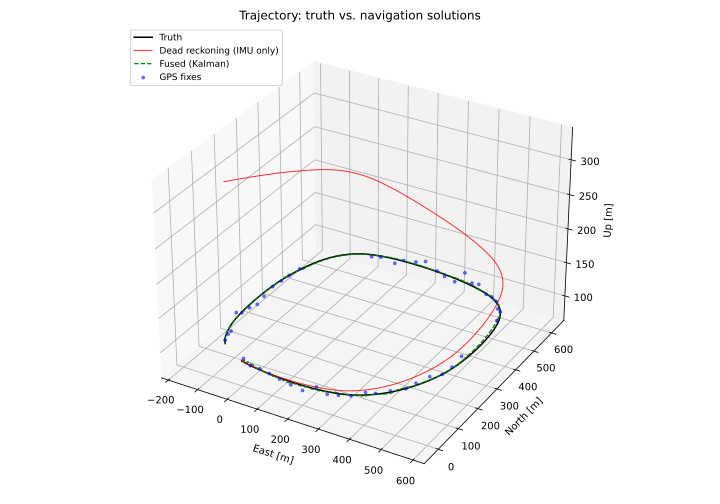
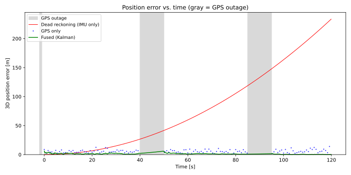
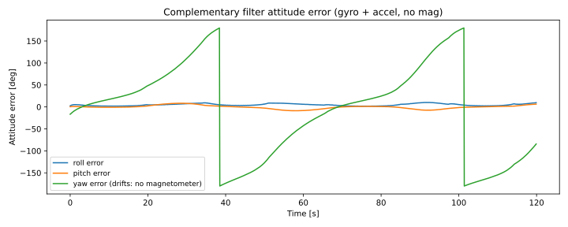

# Sensor Fusion Lab

**Every drone and missile does this math 100 times a second.**

This project is a from-scratch implementation of the core navigation algorithm inside UAVs, guided weapons, and autonomous vehicles: fusing a noisy **IMU** with a noisy, intermittent **GPS** using a **Kalman filter** — and proving, with real numbers, why the fusion beats either sensor alone.

No black boxes. NumPy only. Every equation is commented.

## Why sensor fusion matters

A UAV navigating on GPS alone is fragile: GPS is noisy (meters of error), updates slowly, and **drops out entirely** in GPS-denied or GPS-degraded environments — urban canyons, mountains, jamming, spoofing. An IMU (accelerometer + gyroscope) measures motion 100× per second and never drops out, but its tiny errors **integrate**: a 0.05 m/s² accelerometer bias becomes hundreds of meters of position error within two minutes.

The Kalman filter is how real systems get the best of both: the IMU provides smooth, high-rate motion between GPS fixes, the GPS bounds the long-term drift, and the filter **learns the IMU's bias online** — then coasts through outages on pure inertia. That is the entire trick of GPS-denied navigation, and you can watch it happen in the plots below.

## The demo

A simulated UAV flies a 120-second surveillance circuit (straight legs, coordinated turns, altitude changes between 90–115 m). Three navigation solutions run side by side:

| Method | Position RMSE | What happens |
|---|---|---|
| Dead reckoning (IMU only) | **105.3 m** | Tiny bias integrates twice → 234 m off by the end |
| GPS only | **6.4 m** | Noisy, and blind during two 10 s outages |
| **Fused (Kalman: IMU + GPS)** | **1.9 m** | Smooth, accurate, coasts through outages |

The fused solution is **3.4× more accurate than raw GPS** and **57× better than dead reckoning**. Final position error: 0.32 m fused vs 233.9 m dead-reckoned.

### Trajectory: truth vs. navigation solutions



Black is the true flight path. The green dashed fused estimate sits right on top of it. Blue dots are raw GPS fixes — scattered meters around truth. Red is dead reckoning, drifting off into the sky (it ends 234 m away).

### Position error vs. time (gray bands = GPS outages)



This is the money plot. Dead reckoning (red) grows **quadratically** — that's double-integrated bias, the fundamental curse of inertial navigation. GPS (blue) is a noisy cloud with two gaps where the signal dies. The fused estimate (green) rides at ~2 m, bumps up slightly while coasting blind through each outage, then snaps back when fixes return.

### Bonus: attitude from gyro + accelerometer (complementary filter)



A Mahony-style complementary filter fuses gyro + accelerometer into roll/pitch/yaw. Tilt stays within a couple of degrees — but **yaw drifts without bound**, because with no magnetometer nothing anchors heading. Real AHRS units carry a magnetometer for exactly this reason.

## How the Kalman filter works

Two steps, repeated forever:

**Predict** (100 Hz, driven by the IMU):
$$\hat{x}^- = F\hat{x} + \text{kinematics}(a_{IMU}), \qquad P^- = FPF^T + Q$$
Integrate the motion forward. Uncertainty $P$ *grows* — we're getting less sure.

**Update** (5 Hz, when a GPS fix arrives):
$$y = z_{GPS} - H\hat{x}^-, \quad K = P^-H^T(HP^-H^T + R)^{-1}, \quad \hat{x} = \hat{x}^- + Ky$$
Compare prediction to measurement. The **Kalman gain** $K$ decides who to trust based on their uncertainties — noisy GPS gets a small vote, confident prediction gets a big one.

The state is 9-dimensional: position, velocity, and **accelerometer bias**. Estimating the bias is the quiet superpower here — the filter figures out the IMU's systematic error *while flying* and subtracts it. During a GPS outage there is simply no update step: the filter keeps predicting, uncertainty grows honestly, and collapses again when fixes return.

## Project layout

| File | What it is |
|---|---|
| `trajectory.py` | Generates the true flight path: waypoint circuit → Catmull-Rom smoothing → constant-speed flight, with true attitude, angular rates, and specific force derived from the kinematics |
| `sensors.py` | Realistic sensor models: MEMS IMU (white noise + turn-on bias + bias random walk) at 100 Hz; GPS (3 m horizontal noise) at 5 Hz with configurable dropouts. Seeded RNG — every run is reproducible |
| `filters.py` | The centerpiece: `ComplementaryFilter` (attitude baseline) and `KalmanFilterNav` (9-state IMU+GPS fusion), plus a `dead_reckoning` baseline. NumPy only, heavily commented |
| `demo.py` | Runs truth → sensors → all three solutions → RMSE scoring → saves plots to `results/` (headless via Agg backend) |
| `main.py` | CLI: `python main.py`, `--quick` (30 s version), `--seed` |
| `tests/test_filters.py` | Four plain-assert tests: fused beats GPS, fused crushes dead reckoning, survives a 15 s outage, zero-noise tracks truth |

## Run it

```bash
pip install -r requirements.txt
python main.py              # full 120 s demo, plots -> results/
python main.py --quick      # 30 s version
python tests/test_filters.py  # the four claims, verified
```

## Roadmap

- **Magnetometer + Extended Kalman Filter** for full 9-DOF attitude — kill the yaw drift and estimate gyro bias too.
- **GPS spoofing simulation**: inject a ramp bias into the fixes and show the innovation sequence (`y`) detecting it — the basis of real anti-spoof monitoring.
- **Tightly-coupled fusion**: feed raw pseudoranges instead of position fixes, so even 2–3 satellites still help (this is what real receivers do).

---

*Built as a portfolio project exploring the navigation math behind autonomous flight.*
